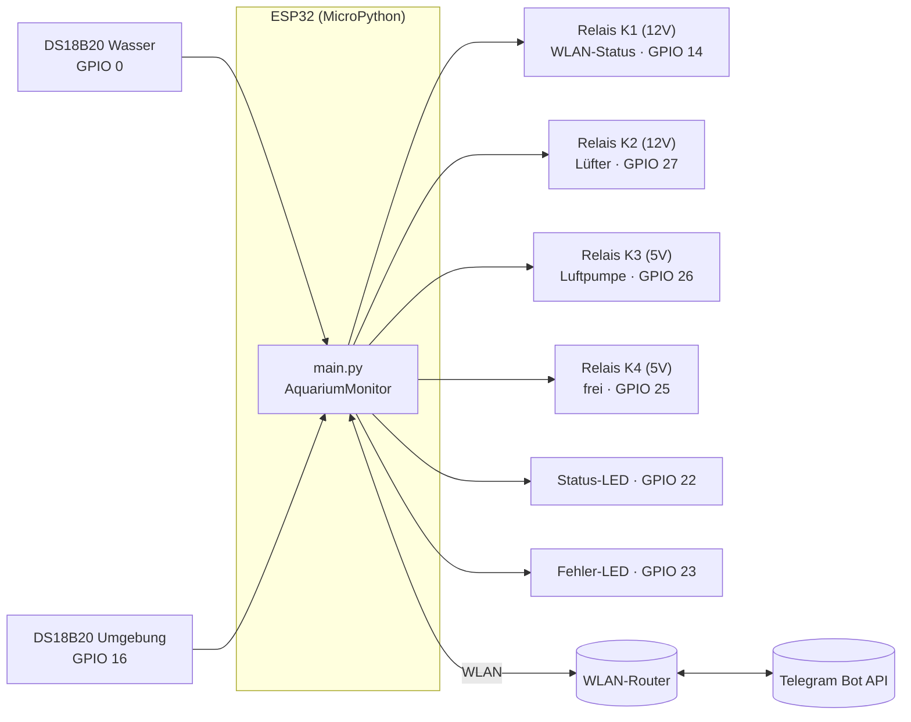
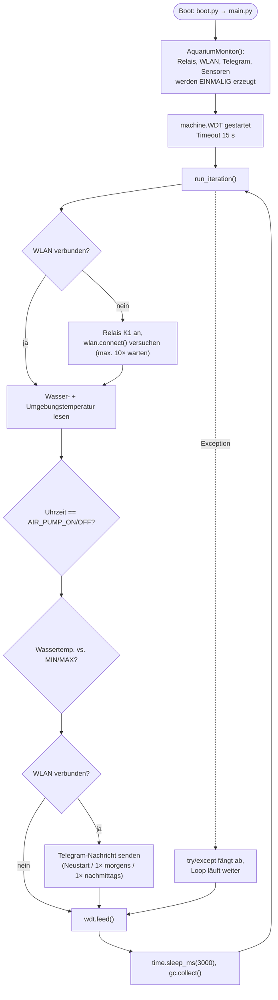
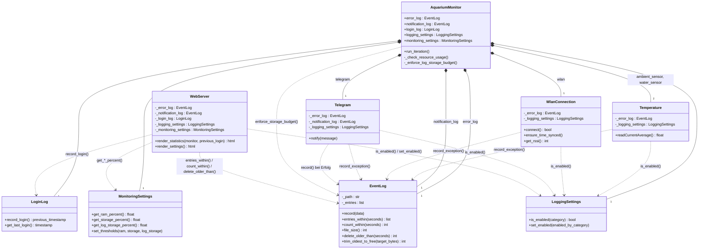

# captain_nemo

Spring 2019 - long weekend at Triest (Italy). As we came home we saw, that it was a doomsday weekend in our aquarium. 5 fishes died, the wather was lightly green.
26°C was to warm.

So the problem was clear. This should never happen.

Project Captain-Nemo was born.

## Was das Projekt macht

Ein ESP32 überwacht Wasser- und Umgebungstemperatur eines Aquariums (via DS18B20-Sensoren), steuert darüber automatisch Lüfter und Luftpumpe per Relais, schickt zweimal täglich (und bei jedem Neustart) den aktuellen Status per Telegram, und versucht dauerhaft im Hintergrund eine WLAN-Verbindung aufrechtzuerhalten. Ein Hardware-Watchdog sorgt dafür, dass sich das Gerät selbst neu startet, falls die Firmware sich aufhängt.

Projekt-Historie, Testsuite-Übersicht und Einsatz von KI-Unterstützung: [PROJECT.md](PROJECT.md). Sicherheitsaspekte der Web-Oberfläche: [SECURITY.md](SECURITY.md).

## Architektur

### Komponentenübersicht



### Ablauf der Hauptschleife



**Warum der Watchdog wichtig ist:** Bleibt `run_iteration()` irgendwo hängen (Netzwerk-Timeout, Sensor-Deadlock etc.), wird `wdt.feed()` nicht mehr aufgerufen. Nach 15 Sekunden ohne Feed löst der ESP32 selbstständig einen Reset aus — kein manuelles Eingreifen mehr nötig.

### Fehlerprotokollierung — Klassen

Vier Erzeuger (`Temperature`, `WlanConnection`, `Telegram`, `main.py`) schreiben über dieselbe Hilfsfunktion `record_exception()` in ein gemeinsames, von `AquariumMonitor` gehaltenes `EventLog`. `WebServer` liest daraus für `/statistics`, ohne die Erzeuger selbst zu kennen.



### Fehlerprotokollierung — Ablauf (Schreiben + Lesen)

```mermaid
sequenceDiagram
    participant Loop as main() Hauptschleife
    participant Sensor as Temperature
    participant Rec as record_exception()
    participant Log as EventLog<br/>(error_log.json)
    participant Browser
    participant Server as WebServer

    Loop->>Sensor: readCurrentAverage()
    Sensor->>Sensor: ds18x20-Lesefehler (OSError)
    Sensor->>Rec: record_exception(error_log, HARDWARE, exc)
    Rec->>Log: record({category, code, message})
    Log->>Log: Timestamp anhängen, auf 200 Einträge kappen,<br/>als JSON auf Flash schreiben

    Note over Browser,Server: später, unabhängig vom Loop

    Browser->>Server: GET /statistics (HTTP Basic Auth)
    Server->>Log: entries_within(30 Tage)
    Log-->>Server: [...Fehlereinträge...]
    Server->>Server: Diagramm (SVG) + Tabelle<br/>(max. 20 Zeilen, siehe MemoryError-Fix)
    Server-->>Browser: HTML-Antwort
```

## Software-Struktur

| Datei | Zweck |
|---|---|
| [boot.py](boot.py) | Wird bei jedem Boot ausgeführt (auch nach Deep-Sleep), aktuell leer |
| [main.py](main.py) | Einstiegspunkt: `AquariumMonitor`-Klasse + Hauptschleife mit Watchdog |
| [config.py](config.py) | Projektname für Telegram-Nachrichten |
| [Temperature/temperature.py](Temperature/temperature.py) | Liest DS18B20-Sensoren über OneWire aus, Mittelwertbildung |
| [Notification/telegram.py](Notification/telegram.py) | Sendet Statusnachrichten per Telegram Bot API |
| [WlanNetwork/wlanconnection.py](WlanNetwork/wlanconnection.py) | WLAN-Verbindungsaufbau inkl. NTP-Zeitsynchronisation |
| [GpioControl/ActorControl.py](GpioControl/ActorControl.py) | Ein-/Ausschalten eines Relais-Kanals |
| [GpioControl/LedControl.py](GpioControl/LedControl.py) | Status-/Fehler-LEDs blinken lassen |
| [WebServer/webserver.py](WebServer/webserver.py) | HTTP-Server-Kern: Routing, HTTP-Basic-Auth, Request-Parsing - delegiert das Rendern/die Formularverarbeitung jeder Seite an `WebServer/pages/*.py` |
| [WebServer/pages/status.py](WebServer/pages/status.py) | Status-Seite (`/`) |
| [WebServer/pages/settings.py](WebServer/pages/settings.py) | Einstellungen (`/settings`) - Name, Warnschwellen, Protokollierung |
| [WebServer/pages/datetimesettings.py](WebServer/pages/datetimesettings.py) | Datum-/Zeit-Einstellungen (`/datetime-settings`) - Country/Culture, UTC-Offset, EU-Sommerzeit; eigene Seite statt Teil von `/settings`, siehe Speicher-Hinweis unten |
| [WebServer/pages/wifisettings.py](WebServer/pages/wifisettings.py) | WLAN-Einstellungen (`/wifi-settings`) |
| [WebServer/pages/statistics.py](WebServer/pages/statistics.py) | Statistik (`/statistics`) |
| [WebServer/webstyle.py](WebServer/webstyle.py) | Gemeinsames CSS (hell/dunkel) für alle vier Seiten |
| [WebServer/settings.py](WebServer/settings.py) | Persistiert den Aquarium-Namen |
| [WlanNetwork/wifisettings.py](WlanNetwork/wifisettings.py) | Persistiert WLAN-Zugangsdaten, die über `/wifi-settings` geändert wurden |
| [WebServer/eventlog.py](WebServer/eventlog.py) | Persistierter, auf 200 Einträge begrenzter Event-Log (Basis für Fehler- und Benachrichtigungs-Protokoll); enthält auch `enforce_storage_budget()` (hält Logs zusammen unter einem Anteil des *verfügbaren* Speichers, nicht der Gesamtkapazität) |
| [WebServer/errorlog.py](WebServer/errorlog.py) | Fehlerkategorien (System/Hardware/Netzwerk/Externe APIs) + Hilfsfunktion zum Mitschreiben einer Exception |
| [WebServer/loggingsettings.py](WebServer/loggingsettings.py) | Persistiert, welche Fehlerkategorien überhaupt protokolliert werden (über `/settings` abschaltbar) |
| [WebServer/loginlog.py](WebServer/loginlog.py) | Persistiert den Zeitpunkt des letzten erfolgreichen Logins |
| [WebServer/datetimeformat.py](WebServer/datetimeformat.py) | Formatiert einen Zeitstempel als Country/Culture-abhängigen String, verschoben um einen festen UTC-Offset plus optional die EU-Sommerzeit (z. B. `17.10.2026 07:05:09 UTC+01` für Österreich im Winter, `UTC+02` im Sommer, vs. `10/17/2026 06:05:09 AM UTC` für die USA) - zentral für alle Datums-/Zeit-Anzeigen, analog zu `format_bytes()` für Zahlenwerte. Die Offset-Verschiebung selbst rechnet in reiner Integer-Arithmetik (Tage/Monate/Jahre korrekt inkl. Schaltjahr), bewusst ohne `time.mktime()` - das behandelt das Tupel auf CPython als *lokale* Zeit (abhängig von der Host-Zeitzone) und hat auf MicroPython gar kein Zeitzonen-Konzept, beide Plattformen würden sich also unterscheiden. Die EU-Sommerzeit-Berechnung (letzter Sonntag im März/Oktober, 01:00 UTC) wurde gegen Pythons `zoneinfo` (Europe/Vienna) minutengenau über 20 Jahre verifiziert (0 Abweichungen) |
| [WebServer/datetimesettings.py](WebServer/datetimesettings.py) | Persistiert die gewählte Country/Culture, den UTC-Offset und ob die automatische EU-Sommerzeit aktiv ist, für die Datums-/Zeit-Anzeige (über `/settings` änderbar) |
| [WebServer/systemstats.py](WebServer/systemstats.py) | RAM- und Flash-Belegung (`gc`, `os.statvfs`) |
| [Monitoring/settings.py](Monitoring/settings.py) | Persistiert die RAM-/Flash-Warnschwellen und den Log-Speicher-Deckel, die über `/settings` geändert wurden |
| `*/config.py` | Je Modul eigene Konfiguration (siehe unten) |

## Konfigurationsparameter

### `config.py` (Projekt-Root)

| Parameter | Bedeutung |
|---|---|
| `AQUARIUM_NAME` | Name, der als Präfix in jeder Telegram-Nachricht erscheint |

### `WlanNetwork/config.py` ⚠️ enthält Secrets, nicht in Git

Nicht eingecheckt (`.gitignore`) — vor dem ersten Deploy aus der Vorlage anlegen:

```bash
cp WlanNetwork/config.example.py WlanNetwork/config.py
```

| Parameter | Bedeutung |
|---|---|
| `SSID` | Name des WLAN-Netzwerks |
| `PASSWORD` | WLAN-Passwort im Klartext |
| `DHCP_HOSTNAME` | Hostname, unter dem sich der ESP32 im Netzwerk meldet |

### `Notification/config.py` ⚠️ enthält Secrets, nicht in Git

```bash
cp Notification/config.example.py Notification/config.py
```

| Parameter | Bedeutung |
|---|---|
| `CHAT_ID` | Telegram-Chat/-Gruppe, an die Nachrichten gesendet werden |
| `BOT_TOKEN` | Token des Telegram-Bots (von [@BotFather](https://t.me/BotFather)) |

### `WebServer/config.py` ⚠️ enthält Secrets, nicht in Git

```bash
cp WebServer/config.example.py WebServer/config.py
```

| Parameter | Bedeutung |
|---|---|
| `PORT` | Port des HTTP-Servers (Standard 80) |
| `ADMIN_PASSWORD` | Schützt `/settings` und `/wifi-settings` per HTTP Basic Auth — siehe [SECURITY.md](SECURITY.md) |

### `GpioControl/config.py`

| Parameter | GPIO | Bedeutung |
|---|---|---|
| `ACTOR_GPIO_WLAN` | 14 | Relais K1 (12V) — an, solange kein WLAN verbunden ist |
| `ACTOR_GPIO_FREE` | 25 | Relais K4 (5V) — aktuell unbenutzt |
| `ACTOR_GPIO_AIR_PUMP` | 26 | Relais K3 (5V) — Luftpumpe |
| `ACTOR_GPIO_FAN` | 27 | Relais K2 (12V) — Lüfter/Kühlung |

### `Temperature/config.py`

| Parameter | Bedeutung |
|---|---|
| `TEMPERATURE_MIN` | Unterhalb dieser Wassertemperatur (°C) wird der Lüfter (K2) eingeschaltet |
| `TEMPERATURE_MAX` | Oberhalb dieser Wassertemperatur (°C) wird der Lüfter (K2) ausgeschaltet |
| `ONE_WIRE_GPIO_AMBIENT` | GPIO des DS18B20 für die Umgebungstemperatur |
| `ONE_WIRE_GPIO_WATER` | GPIO des DS18B20 für die Wassertemperatur (GPIO 0 ist ein Boot-Strapping-Pin — siehe Hinweis unten) |

### `Airpump/config.py`

| Parameter | Bedeutung |
|---|---|
| `AIR_PUMP_ON` | Stunde (0–23, UTC), zu der die Luftpumpe (K3) eingeschaltet wird |
| `AIR_PUMP_OFF` | Stunde (0–23, UTC), zu der die Luftpumpe (K3) ausgeschaltet wird |

`time.gmtime()` liefert **UTC**. Die Werte sind deshalb als `19 - 2` bzw. `20 - 2` geschrieben — das `-2` rechnet die gewünschte Lokalzeit (19:00 / 20:00 in MESZ, UTC+2) auf UTC um. Bei anderer Zeitzone oder Winterzeit (UTC+1) entsprechend anpassen.

### `Notification/telegram.py` — Konstruktor-Parameter der `Telegram`-Klasse

| Parameter | Default | Bedeutung |
|---|---|---|
| `project_name` | `"--not set--"` | wird durch `AQUARIUM_NAME` aus `config.py` gesetzt |
| `morning_hour_message` | `8 - 2` (= 6 UTC) | Stunde für die morgendliche Statusnachricht (gleiche UTC-Umrechnung wie oben) |
| `afternoon_hour_message` | `16 - 2` (= 14 UTC) | Stunde für die nachmittägliche Statusnachricht |

### `main.py`

| Parameter | Bedeutung |
|---|---|
| `WATCHDOG_TIMEOUT_MS` | Zeit in Millisekunden, nach der der Watchdog ohne `feed()` einen Reset auslöst (aktuell 15000 = 15 s) |

### `Monitoring/config.py`

Keine Secrets, daher regulär in Git. Werte sind auch über `/settings` zur Laufzeit änderbar (siehe unten) — eine Änderung dort überschreibt diese Defaults dauerhaft.

| Parameter | Bedeutung |
|---|---|
| `RAM_FREE_WARNING_PERCENT` | Fällt der freie RAM unter diesen Prozentsatz, wird einmalig eine Telegram-Warnung gesendet (erst nach Erholung über den Schwellwert wieder scharf) |
| `STORAGE_FREE_WARNING_PERCENT` | Dasselbe für den freien Flash-Speicher |
| `MAX_LOG_STORAGE_PERCENT` | Fehler- und Benachrichtigungs-Log dürfen zusammen höchstens diesen Anteil des **noch verfügbaren Speichers** belegen (nicht der Gesamtkapazität — siehe Hinweis unten), geprüft bei jedem Loop-Durchlauf; älteste Einträge werden sonst automatisch entfernt (`WebServer/eventlog.py: enforce_storage_budget()`) |

> Das Budget bezieht sich bewusst auf den **Spielraum** (aktuell freier Speicher + aktuelle Log-Größe), nicht auf die Gesamtkapazität. Ein fixer Anteil der Gesamtkapazität bliebe gleich groß, egal wie viel Platz andere Daten tatsächlich noch übrig lassen — würde der freie Speicher aus einem anderen Grund schrumpfen, könnten die Logs trotzdem "im Budget" bleiben, während kaum noch Platz frei ist. Durch die Bindung an den aktuellen Spielraum bleibt immer mindestens `(100 − MAX_LOG_STORAGE_PERCENT)%` davon garantiert frei, und die Logs schrumpfen automatisch mit, wenn der freie Speicher aus anderen Gründen knapper wird.

## Web-Oberfläche

| URL | Zugriff | Zweck |
|---|---|---|
| `http://<IP>/` | öffentlich | Temperaturen, Online-Status, Zeitstempel der letzten Messung |
| `http://<IP>/settings` | Admin-Passwort | Aquarium-Namen ändern, RAM-/Flash-/Log-Speicher-Warnschwellen anpassen, Fehlerprotokollierung je Kategorie ein-/ausschalten |
| `http://<IP>/datetime-settings` | Admin-Passwort | Datum-/Zeit-Anzeigeformat (Country/Culture) + Zeitzone (fester UTC-Offset) + automatische EU-Sommerzeit wählen — eigene Seite, damit die größte einzelne Formular-Sektion (Culture- + Zeitzonen-Dropdown, ~45 Optionen) nicht Teil von `/settings` sein muss (siehe Speicher-Hinweis unten) |
| `http://<IP>/wifi-settings` | Admin-Passwort | WLAN-Netzwerk per Dropdown wählen + neues Passwort setzen; speichert und startet das Gerät neu |
| `http://<IP>/statistics` | Admin-Passwort | RAM-/Flash-Belegung (inkl. Log-Speicherverbrauch gegen den konfigurierten, vom verfügbaren Speicher abhängigen Deckel), letzter Login, WLAN-Signalstärke, Anzahl gesendeter Benachrichtigungen (30 Tage), Fehler-Diagramm + -Tabelle (30 Tage, nach System/Hardware/Netzwerk/Externe APIs, max. die letzten 20 Zeilen), Formular zum manuellen Löschen von Log-Einträgen älter als X Minuten. Aktualisiert sich automatisch alle 30 s. |

`/` aktualisiert sich ebenfalls automatisch alle 30 s; `/settings` und `/wifi-settings` nicht.

> **Zeitzone ist ein fester UTC-Offset, keine echte Zeitzone.** Der ESP32 hat weder genug Flash für eine vollständige IANA-Zeitzonendatenbank (Sommerzeit-Regeln je Land, mehrere hundert KB) noch einen Mechanismus, um solche Regeln aktuell zu halten. Der Offset wird deshalb per `/datetime-settings` manuell gewählt (z. B. "UTC+01:00 (Wien, Berlin, Paris, Rom)"), genau wie bei anderen kleinen IoT-Geräten (Shelly, Tasmota) ohne eigene Zeitzonen-Datenbank.
>
> **Automatische Sommerzeit gibt es nur nach der EU-Regel** (letzter Sonntag im März/Oktober, Umstellung um 01:00 UTC — EU-Richtlinie 2000/84/EG), über eine eigene Checkbox auf `/datetime-settings` aktivierbar. Das Projekt ist damit vorerst bewusst auf Europa ausgelegt: Andere Regionen haben andere Umstellungstermine (USA/Kanada: zweiter Sonntag März / erster Sonntag November) oder gar keine Sommerzeit — wer außerhalb Europas ist, lässt die Checkbox einfach aus und stellt den UTC-Offset bei Bedarf selbst zweimal im Jahr um.
>
> **Warum eine eigene Seite statt ein paar Felder auf `/settings`:** Die Culture- + Zeitzonen-Dropdowns allein sind ~45 Optionen — mit Abstand der größte einzelne Formular-Block im ganzen Web-Interface. Solange das Teil von `/settings` war, führte das wiederholt zu `MemoryError` beim Speichern (Heap-Fragmentierung auf dem ESP32, siehe SECURITY.md). Eine eigene, kleinere Seite senkt die größte benötigte zusammenhängende Speicher-Allokation spürbar (gemessen: von ~9,7 KB auf ~5,8 KB für die größere der beiden Seiten) statt das Problem nur mit einem Retry-Mechanismus zu kaschieren.

Details zur Absicherung (Zugriffsschutz, Eingabevalidierung, bekannte Grenzen) stehen in [SECURITY.md](SECURITY.md).

## Setup — Schritt für Schritt

1. **Hardware verkabeln** gemäß der GPIO-Tabelle oben (2× DS18B20 mit Pull-up-Widerstand ~4,7 kΩ am Datenpin, 4-Kanal-Relais-Modul, 2 LEDs mit Vorwiderstand an GPIO 22/23).
   > ⚠️ GPIO 0 ist ein Boot-Strapping-Pin des ESP32 (muss beim Einschalten high/floating sein, um normal zu booten). Funktioniert mit dem OneWire-Pull-up meist problemlos, aber im Hinterkopf behalten, falls das Board nicht bootet.
2. **MicroPython-Firmware** auf den ESP32 flashen (z. B. mit [esptool.py](https://github.com/espressif/esptool) oder Thonny).
3. **Repo klonen** und ins Projektverzeichnis wechseln.
4. **Echte Zugangsdaten anlegen** (werden bewusst nicht in Git versioniert):
   ```bash
   cp WlanNetwork/config.example.py WlanNetwork/config.py
   cp Notification/config.example.py Notification/config.py
   cp WebServer/config.example.py WebServer/config.py
   # in allen drei Dateien die Platzhalter durch echte Werte ersetzen
   ```
5. **Benötigtes Tool installieren** — [pyserial](https://github.com/pyserial/pyserial):
   ```bash
   pip install pyserial
   ```
6. **Dateien auf den ESP32 übertragen** mit [scripts/deploy_esp32.py](scripts/deploy_esp32.py):
   ```bash
   # einmal den USB-Port herausfinden:
   ls /dev/cu.usbserial*   # macOS
   ls /dev/ttyUSB*         # Linux

   python3 scripts/deploy_esp32.py                       # komplettes Projekt übertragen
   python3 scripts/deploy_esp32.py WebServer/webserver.py   # nur eine einzelne Datei
   python3 scripts/deploy_esp32.py --port /dev/ttyUSB0    # falls der Port nicht /dev/cu.usbserial-0001 ist
   ```
   Welche Dateien übertragen werden, steht in der `FILES`-Liste im Skript — `tests/`, `.github/`, `README.md`, `.gitignore` und `*.example.py` gehören bewusst **nicht** dazu, die bleiben auf dem Dev-Rechner.

   Das Skript öffnet die Raw-REPL-Verbindung selbst und überträgt jede Datei in kleinen 512-Byte-Häppchen statt als ein großes Stück. Beides war nötig, nachdem sich in diesem Projekt zwei konkrete Probleme mit [`mpremote`](https://docs.micropython.org/en/latest/reference/mpremote.html) gezeigt hatten: Es scheiterte zuverlässig mit `could not enter raw repl`, wenn das Board gerade in einer Endlosschleife steckte (z. B. WLAN-Reconnect), und größere Dateien (ab ein paar KB) ließen sich gar nicht übertragen, weil die Übertragung als ein einziger Block eine einzige große, zusammenhängende Speicher-Allokation braucht, die auf dem ESP32 selbst direkt nach einem Neustart mit `MemoryError` fehlschlägt. Das Skript war die Lösung für beide Probleme — siehe Docstring in [scripts/deploy_esp32.py](scripts/deploy_esp32.py) für Details.

   `mpremote` (`pip install mpremote`) ist trotzdem nützlich, um schnell in die laufende REPL zu schauen (serielle Konsole, `Strg+C`/`Strg+D` zum Unterbrechen/Neustarten):
   ```bash
   mpremote connect /dev/cu.usbserial-0001
   ```
7. **Board neu starten** — passiert nach `deploy_esp32.py` bereits automatisch per Soft-Reset; sonst Reset-Taste oder Stromzyklus.
8. **Tests lokal ausführen** (reines `unittest`, keine zusätzlichen Abhängigkeiten):
   ```bash
   python3 -m unittest discover -s tests -v
   ```
9. **CI:** [.github/workflows/tests.yml](.github/workflows/tests.yml) führt dieselben Tests automatisch bei jedem `git push`/Pull Request aus (Ergebnis im GitHub-Tab „Actions“).

## Tests

Siehe [tests/](tests/) — `tests/micropython_mocks.py` stellt Stubs für die MicroPython-only-Module (`machine`, `network`, `ds18x20`, `onewire`, `ntptime`, `urequests`) bereit, damit die Logik unter normalem CPython (auch in CI) testbar ist, ohne echte Hardware zu benötigen.
